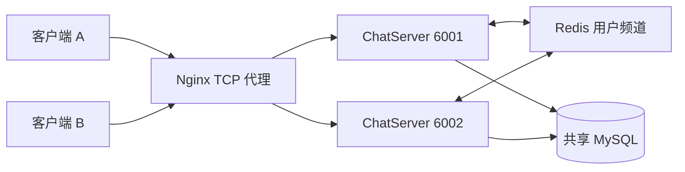

# ChatServer

基于 C++、Muduo、MySQL、Redis 和 Nginx 的即时通信项目，支持单聊、群聊、离线消息和跨服务端消息转发。

本仓库包含完整项目源码、Linux 构建脚本、双节点部署配置、隔离集成测试和项目学习笔记。

## 项目笔记

**[查看或下载 Word 项目笔记](docs/ChatServer-notes.docx)**

笔记共 22 页，包含可点击章节导航、接口参数说明、代码示例和源码阅读索引。主要内容包括：

- 网络层、业务层、数据层的职责与调用关系。
- 注册、登录、好友管理、单聊、建群、入群、群聊和退出的完整流程。
- `std::function`、`std::bind`、Lambda、线程、互斥锁和条件变量。
- Muduo 的 `EventLoop`、`TcpServer`、`TcpConnection`、`Buffer` 及 I/O 线程池。
- MySQL 常用接口、离线消息存取和数据库连接池与线程池的区别。
- Redis 用户频道发布订阅、跨服务端转发、断线重连与订阅恢复。
- Nginx TCP 负载均衡、长连接分配及连接故障处理。
- TCP 拆包粘包、消息持久化边界、常见面试问题与改进方向。

GitHub 不直接预览 Word 正文，可进入文件页面下载后使用 Word 或 WPS 阅读。

## 系统架构



- **网络层**：Muduo 管理 TCP 长连接，接收数据、提取完整消息并触发回调。
- **业务层**：按 `msgid` 分发请求，维护本机用户连接和业务状态。
- **数据层**：通过数据模型访问 MySQL，保存用户、好友、群成员和离线消息。
- **跨服务端通信**：Redis 根据用户频道订阅关系将消息转发到接收者所在节点。
- **连接分配**：Nginx 使用 `stream` 模块代理 TCP，新连接按最少连接策略分配后端。

## 核心功能

| 功能 | 实现方式 |
| --- | --- |
| 注册与登录 | MySQL 用户信息校验，条件更新抢占在线状态 |
| 好友管理 | 保存用户与好友的单向关系 |
| 单聊 | 本机连接直接发送，远端用户通过 Redis 转发 |
| 群聊 | 查询除发送者之外的群成员，逐个执行投递 |
| 离线消息 | 实时投递不可用时保存 JSON，登录后查询并补发 |
| TCP 消息分帧 | 按分隔符累积半包、拆分多条消息，限制单帧大小 |
| Redis 恢复 | 观察线程自动重连并恢复本机用户订阅 |
| 会话清理 | 断线和正常退出时仅清理本进程负责的用户 |

### 跨服务端消息如何流转

例如张三连接节点 A，李四连接节点 B：

```text
张三发送消息
  → A 查本机连接表，未找到李四
  → 发布到 chat:user:<李四ID>
  → Redis 推送给订阅该频道的 B
  → B 找到李四的 TCP 连接并发送
```

每个节点只订阅本机登录用户的频道，不需要订阅其他节点的所有用户。发布返回没有订阅者或发布失败时，消息进入 MySQL 离线消息表。群聊复用同样的逐用户投递路径。

### TCP 拆包粘包如何处理

TCP 是字节流，一次发送不对应一次接收。实现中先将字节累积到缓冲区，再按分隔符循环提取完整 JSON；不完整的尾部保留到下一次接收。

服务端回复使用换行分隔，同时接收换行或原客户端的 NUL 分隔请求；单条消息限制为 1 MiB。

## 技术栈与数据模型

| 技术 | 用途 |
| --- | --- |
| C++ | 业务逻辑、资源管理、回调与线程同步；当前构建配置为 C++17 |
| Muduo | TCP 连接管理与 Reactor 事件循环 |
| MySQL | 用户、关系和离线消息持久化 |
| Redis 与 hiredis | 用户频道发布订阅与跨服务端转发 |
| Nginx stream | TCP 长连接代理与负载均衡 |
| nlohmann/json | JSON 序列化与反序列化 |
| CMake、Shell、Python | Linux 构建、部署及集成测试 |

主要表为 `user`、`friend`、`all_group`、`groupuser`、`offlinemsg`。

## 快速开始

### 1. 克隆与编译

在 Ubuntu 或 WSL Ubuntu 中运行：

```bash
git clone https://github.com/zhouNorth/ChatServer.git
cd ChatServer
bash scripts/setup-linux.sh
```

安装脚本通过 apt 安装构建工具、Boost、MySQL 客户端开发库、hiredis、Redis 和 Nginx stream 模块，并下载、构建 muduo v2.0.2。

后续修改源码后重新编译：

```bash
bash scripts/build-linux.sh
```

输出位于 `chatserver/bin/ChatServer` 和 `chatserver/bin/ChatClient`，均为 Linux 可执行程序。

### 2. 配置 MySQL

准备一个可访问的 MySQL 服务和本项目专用数据库。默认表结构位于 [deploy/schema.sql](deploy/schema.sql)。以下环境变量需要在启动服务端的终端中设置：

```bash
export CHAT_DB_HOST=127.0.0.1
export CHAT_DB_PORT=3306
export CHAT_DB_USER=root
export CHAT_DB_PASSWORD='替换为实际数据库密码'
export CHAT_DB_NAME=chat

# 在有建库权限的账号下创建数据库；命令会交互式询问密码。
mysql -h "$CHAT_DB_HOST" -P "$CHAT_DB_PORT" -u "$CHAT_DB_USER" -p \
  -e "CREATE DATABASE IF NOT EXISTS chat CHARACTER SET utf8mb4;"
mysql -h "$CHAT_DB_HOST" -P "$CHAT_DB_PORT" -u "$CHAT_DB_USER" -p \
  "$CHAT_DB_NAME" < deploy/schema.sql
```

若使用已有表，请先确认字段与源码一致；初始化 SQL 不负责迁移已有表结构。

### 3. 准备 Redis 并启动双节点

先确认 Redis 可用；若本机尚未启动 Redis，可启动一个仅监听本机的开发实例：

```bash
redis-server --bind 127.0.0.1 --port 6379 --daemonize yes
redis-cli -p 6379 ping

export CHAT_REDIS_HOST=127.0.0.1
export CHAT_REDIS_PORT=6379
export CHAT_REDIS_PREFIX=chat:user:
# 如果 Redis 启用密码，再设置 CHAT_REDIS_PASSWORD。

bash scripts/run-cluster.sh
```

启动器运行后端 `6001`、`6002` 和前端 `8000`，保持该终端运行。Ctrl+C 停止启动器管理的服务端与 Nginx 实例。

### 4. 连接客户端

在另外两个终端分别运行：

```bash
./chatserver/bin/ChatClient 127.0.0.1 8000
```

注册后使用返回的用户 ID 登录。常用命令：

| 命令 | 用途 |
| --- | --- |
| `help` | 查看命令 |
| `chat:用户ID:内容` | 单聊 |
| `addfriend:用户ID` | 添加好友 |
| `creategroup:群名:描述` | 创建群组 |
| `addgroup:群ID` | 加入群组 |
| `groupchat:群ID:内容` | 群聊 |
| `loginout` | 注销并退出客户端 |

当前创建群组尚未返回群 ID，可由数据库或下次登录加载的群列表查看；操作回执等限制见下方说明。

详细步骤参见 [集群运行说明](README-Cluster.md) 和 [Linux 构建说明](README-Linux.md)。

## 已验证的功能场景

本工程已通过隔离的 MySQL、Redis、Nginx 和双 ChatServer 集成测试，覆盖：

- 经 Nginx 连接不同后端的双向单聊和群聊。
- 重复登录拒绝、离线回退、大消息及 UTF-8 消息。
- TCP 请求拆分、合并及原 NUL 分隔协议兼容。
- 原生 C++ 客户端注册、登录和退出。
- 用户退订、Redis 重连恢复及单进程退出隔离。

这些是功能验证，不代表已经完成高并发压测；本项目不提供未经测量的吞吐量或延迟指标。

复现测试需要 MySQL 服务端二进制，测试会使用临时数据库目录和随机端口：

```bash
sudo apt-get install -y default-mysql-server
sudo python3 -u tests/cluster_integration.py
```

测试不访问已有业务数据库，结束后清理自己启动的临时服务。

## 当前边界

- 服务端当前为一个网络 EventLoop 加一个 Redis 观察线程，未启用额外 Muduo I/O 工作线程。
- MySQL 同步访问，尚未实现独立业务线程池或数据库连接池。
- Redis Pub/Sub 不提供持久化和端到端确认，重连不等于断线期间消息自动重放。
- 离线消息目前查询后删除，没有客户端 ACK；在线消息没有独立历史记录表。
- 客户端断线后退出，尚未实现自动重连与会话恢复。
- 进程崩溃可能残留数据库在线状态，尚未实现分布式会话租约。
- 好友审批、群成员权限、密码哈希和参数化 SQL 尚未全面完善。

## 仓库目录

```text
ChatServer/
├── README.md
├── README-Cluster.md          # 集群运行与可靠性边界
├── README-Linux.md            # Linux 与 WSL 构建
├── chatserver/
│   ├── CMakeLists.txt
│   ├── include/              # 业务与数据模型头文件
│   ├── src/client/           # 客户端
│   ├── src/server/           # 网络层 业务层 MySQL Redis
│   └── thirdparty/json.hpp   # 随项目保留的 JSON 头文件
├── deploy/                   # Nginx 配置与数据库表结构
├── scripts/                  # 安装 构建 双节点启动
├── tests/                    # 隔离集成测试
└── docs/ChatServer-notes.docx # 项目学习笔记
```

笔记内容以当前实现为基础，明确区分已实现功能、学习示例和后续优化方向。
